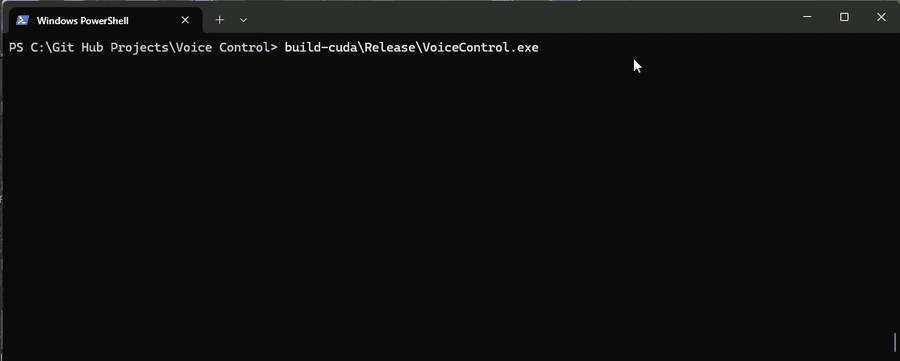
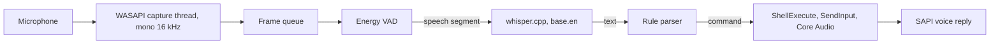

# VoiceControl

Offline voice assistant for Windows in C++: it listens to the microphone, recognizes short English commands and controls the PC.

[](LICENSE)




The console shows each phrase the program heard: the recognized text, the recognition time and the confirmation that is printed after the action ran. In this recording the commands opened Chrome and Spotify, set the volume to maximum, toggled playback and skipped a track.

## What it does

You say a short command, the program runs it and answers with a spoken confirmation. A command matches when its words appear in the recognized text as whole words, so "open chrome" and plain "chrome" both work.

- chrome, google, browser: open Chrome
- spotify, open music: open Spotify
- notepad, notes: open Notepad
- calculator, calc: open Calculator
- volume up, louder, turn it up, plus: volume up by 10 percent
- volume down, quieter, turn it down, minus: volume down by 10 percent
- max volume, full volume: set the volume to 100 percent
- half volume: set the volume to 50 percent
- mute, unmute, sound off, sound on: toggle mute
- next track, next song, skip: next track
- previous track, previous song, go back: previous track
- play, pause, resume, stop music: toggle play and pause
- show desktop, minimize: show the desktop (Win+D)
- lock screen, lock the computer: lock the PC

## Highlights

Own voice activity detection (src/vad). No VAD library: the code takes the RMS energy of every 20 ms frame and runs a two state machine. Three loud frames in a row start a phrase, twenty quiet frames (400 ms) end it. The start and the end use different counts so that a short pause between two words does not cut the phrase in half. The 100 ms before the first loud frame are kept and put in front of the phrase, because quiet consonants at the start of a word can fall below the threshold. Only the speech segment goes to whisper.

A pipeline of small stages. A WASAPI capture thread fills a thread-safe queue with 16 kHz mono frames, the main loop passes them through VAD, whisper.cpp, the parser, the actions and the SAPI reply. The stages only exchange plain types (a vector of floats, a string, a Command struct), so each one can be changed or tested without touching the others.

Offline. whisper.cpp runs the base.en model on the machine (CPU, or GPU with CUDA), the command parser is a rule table and the voice reply comes from Windows SAPI. The program itself has no network code. Nothing in the recognition or the command logic calls an external AI service.

The parser is a table. A rule is a list of trigger phrases, a command type, a confirmation text and an optional argument, so a new app is one line. How strict a rule is depends on what a false match costs: Chrome fires on one word, locking the screen needs two.

Tuned on real output instead of guesses. The command list for whisper (initial_prompt) is built from the same rule table. Trigger words were chosen by what whisper returned in my runs: "louder" came back as "Flourder" and "loader", while "plus" and "minus" came back correctly, so both sets are triggers. After the assistant speaks, the audio queue is cleared, because a confirmation such as "Volume up" is itself a valid command.

## Quick start

Needs Windows, a microphone, CMake and Visual Studio with the C++ workload. Tested on Windows 11 with Visual Studio 2026 (MSVC 19.51) and CMake 4.4, nothing else was tried.

```
git clone --recurse-submodules https://github.com/STORM0090/voice-control.git
cd voice-control
curl.exe -L -o models/ggml-base.en.bin https://huggingface.co/ggerganov/whisper.cpp/resolve/main/ggml-base.en.bin
cmake -S . -B build
cmake --build build --config Release
build\Release\VoiceControl.exe
```

The model is about 148 MB. The program looks for it in models/ and also accepts a path as the first argument. Wait for "Listening...", then speak. Ctrl+C quits.

For speech recognition on an NVIDIA GPU, install the CUDA Toolkit (tested with 13.3, open a new terminal afterwards so the CUDA environment variables are visible) and configure with one more option. The build copies the CUDA DLLs next to the exe.

```
cmake -S . -B build-cuda -DGGML_CUDA=ON
cmake --build build-cuda --config Release
build-cuda\Release\VoiceControl.exe
```

## How it works



- src/audio: WASAPI in shared, event-driven mode. Channels are mixed to mono, resampled to 16 kHz by linear interpolation and cut into 20 ms frames.
- src/vad: the voice activity detection described above.
- src/stt: a wrapper around whisper.cpp with greedy decoding, English only, 4 threads.
- src/command: text normalization and the rule table.
- src/action: ShellExecute opens apps, SendInput presses media keys and Win+D, LockWorkStation locks the PC, and the Core Audio API sets the volume.
- src/tts: Windows SAPI.

Recognition time is the length of one Transcriber::transcribe call, measured with std::chrono::steady_clock and printed by the app after every phrase. On a GTX 1660 SUPER with base.en, the median was 224 ms on the GPU for calls made back to back, 406 ms with 2 s pauses between calls, and 1283 ms on the CPU. These numbers come from a separate throwaway program (not in this repository) that called the same Transcriber on six synthetic commands (Windows SAPI voice, 1.3 to 1.8 s long): 60 back-to-back calls per build, and 30 calls for each pause length. With my own voice through the app, the GPU build printed a median of 433 ms over 24 phrases, range 272 to 655 ms. The CPU number was not re-measured in live use.

## Tests

VoiceControl.exe --test runs 31 checks of the parser and exits with code 1 if any fail. The inputs are sample strings, some copied from real whisper output such as " Open Home." and " and calculator.", plus cases that must not match ("soundtrack", a lone "lock"). It needs no model, microphone or GPU. Audio capture, VAD and the actions have no automated tests, I checked them by hand.

.github/workflows/build.yml builds the CPU version on a Windows runner and runs the same tests.

## Limitations

- Windows only: WASAPI, SAPI and the Win32 calls have no portable counterpart here.
- English only: the base.en model, the language set to English and English trigger words.
- It records the default microphone only. In shared mode the device format must be 32-bit float, otherwise the program stops with an error.
- There is no wake word. Any recognized phrase that contains a trigger word as a whole word runs the command, for example a sentence with "plus" in it.
- Single short words are unreliable. In my runs "chrome" alone came back as "from", "card" or "Rome", which is why "google" and "browser" also open Chrome.
- On noise whisper sometimes returns text such as "Thank you." or "[BLANK_AUDIO]". These match no command and are ignored.
- The volume changes in fixed steps of 10 percent, and only "max volume" and "half volume" set an exact level.
- "mute" and "unmute" both press the mute key, so each one toggles.
- Tested on one machine with one microphone and one speaker.

## Roadmap

- Test the VAD on recorded WAV files.
- Choose the microphone and the VAD threshold from the command line.
- Load the command table from a file instead of the source code.
- A wake word, so that normal speech does not trigger commands.

## License

MIT, see LICENSE. whisper.cpp (MIT) is included as a git submodule. The base.en model comes from the OpenAI Whisper release and is listed as MIT on its Hugging Face page.
